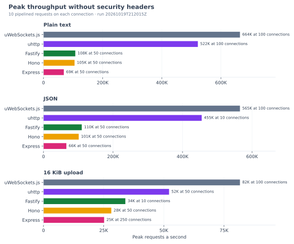
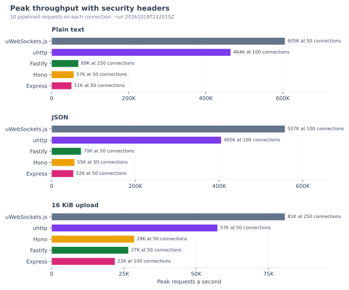
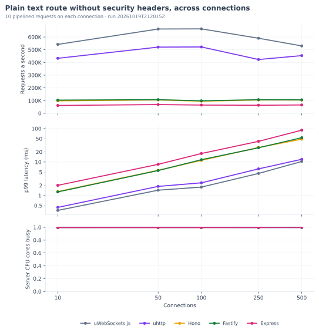
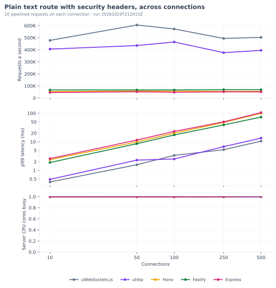
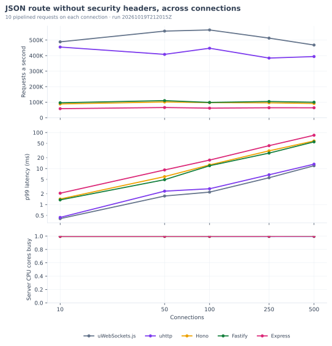
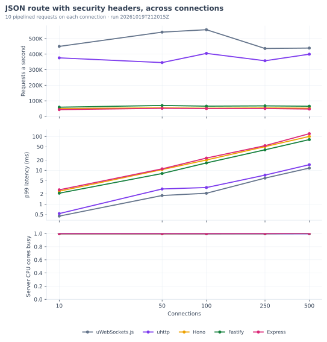
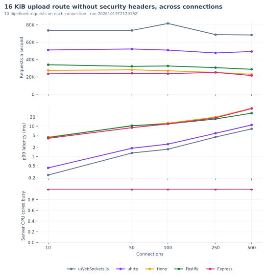
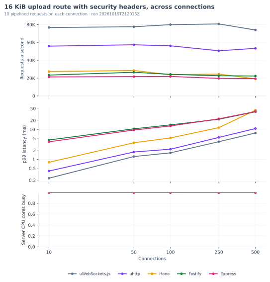
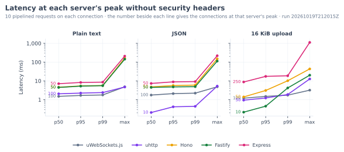
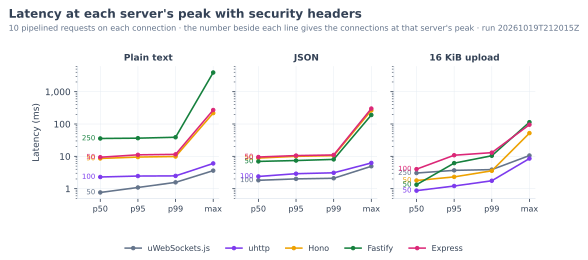

# Benchmarks

On this page, you can compare the number of requests a second that uhttp serves with the rates of uWebSockets.js and of three Node.js frameworks: Hono on its Node.js adapter, Fastify, and Express. A maintainer starts the suite in [`benchmarks/suite/`](benchmarks/suite/) when somebody asks for new figures. From the newest run under [`benchmarks/results/runs/`](benchmarks/results/runs/), the generator in [`benchmarks/writeup/`](benchmarks/writeup/) then writes every number, table, and chart on this page.

<!-- BENCH:run START -->
The suite recorded every figure on this page on 2026-10-19, in run [`20261019T212015Z`](benchmarks/results/runs/20261019T212015Z/comparison.md). You can find the hardware and the software of that run under [The machine](#the-machine).
<!-- BENCH:run END -->

## Peak throughput

The length of each bar is the highest rate that a server reached at any of the connection counts that the suite measured. In the first chart, each server sends only the headers that it sends by default. In the second chart, every server sends the same ten security headers, which you can find under [Security headers](#security-headers).

<!-- BENCH:peak START -->
### With 10 pipelined requests on each connection




<!-- BENCH:peak END -->

## Requests a second at 100 connections

These tables show every server's figures at 100 connections under two loads. Without pipelining, h2load sends the next request on a connection only after the reply to the previous one has arrived. With pipelining, h2load keeps 10 requests in flight on each connection, which is the load that the maintainers of Fastify use for each framework in their [benchmark repository](https://github.com/fastify/benchmarks). A server with a figure above 100% in the third column served more requests than uWebSockets.js under the same load.

<!-- BENCH:tables START -->
In each table, the servers appear in the order of their requests a second at 100 connections. In the last column, you can read each server's highest rate across every connection count, with the connections at which the server reached that rate.

### With 10 pipelined requests on each connection

#### Plain text route without security headers

| Server | Requests a second | Share of the uWebSockets.js rate | p50 (ms) | p99 (ms) | Server CPU cores | Peak requests a second |
| --- | ---: | ---: | ---: | ---: | ---: | ---: |
| uWebSockets.js | 664,229 | 100.0% | 1.50 | 1.78 | 1.00 | 664,229 at 100 |
| uhttp | 521,912 | 78.6% | 2.05 | 2.39 | 1.00 | 521,912 at 100 |
| Fastify | 98,220 | 14.8% | 10.0 | 11.8 | 1.00 | 107,534 at 50 |
| Hono | 95,413 | 14.4% | 10.5 | 11.2 | 1.00 | 105,035 at 50 |
| Express | 64,810 | 9.8% | 15.8 | 18.0 | 1.00 | 68,699 at 50 |

#### JSON route without security headers

| Server | Requests a second | Share of the uWebSockets.js rate | p50 (ms) | p99 (ms) | Server CPU cores | Peak requests a second |
| --- | ---: | ---: | ---: | ---: | ---: | ---: |
| uWebSockets.js | 565,257 | 100.0% | 1.76 | 2.22 | 1.00 | 565,257 at 100 |
| uhttp | 447,439 | 79.2% | 2.36 | 2.75 | 1.00 | 455,163 at 10 |
| Fastify | 98,504 | 17.4% | 10.3 | 12.0 | 1.00 | 110,141 at 50 |
| Hono | 97,351 | 17.2% | 10.8 | 12.6 | 1.00 | 101,384 at 50 |
| Express | 61,697 | 10.9% | 16.4 | 17.2 | 1.00 | 65,794 at 50 |

#### 16 KiB upload route without security headers

| Server | Requests a second | Share of the uWebSockets.js rate | p50 (ms) | p99 (ms) | Server CPU cores | Peak requests a second |
| --- | ---: | ---: | ---: | ---: | ---: | ---: |
| uWebSockets.js | 81,629 | 100.0% | 1.20 | 1.74 | 1.00 | 81,629 at 100 |
| uhttp | 50,889 | 62.3% | 1.96 | 2.56 | 1.00 | 52,171 at 50 |
| Fastify | 32,588 | 39.9% | 2.34 | 11.8 | 1.00 | 34,012 at 10 |
| Hono | 27,044 | 33.1% | 3.03 | 12.5 | 1.00 | 28,171 at 50 |
| Express | 23,693 | 29.0% | 3.85 | 11.8 | 1.00 | 25,192 at 250 |

#### Plain text route with security headers

| Server | Requests a second | Share of the uWebSockets.js rate | p50 (ms) | p99 (ms) | Server CPU cores | Peak requests a second |
| --- | ---: | ---: | ---: | ---: | ---: | ---: |
| uWebSockets.js | 572,430 | 100.0% | 1.81 | 3.34 | 1.00 | 605,234 at 50 |
| uhttp | 464,383 | 81.1% | 2.30 | 2.49 | 1.00 | 464,383 at 100 |
| Fastify | 66,504 | 11.6% | 15.4 | 17.3 | 1.00 | 69,202 at 250 |
| Hono | 56,132 | 9.8% | 17.5 | 20.1 | 1.00 | 57,336 at 50 |
| Express | 47,334 | 8.3% | 21.0 | 23.1 | 1.00 | 51,475 at 50 |

#### JSON route with security headers

| Server | Requests a second | Share of the uWebSockets.js rate | p50 (ms) | p99 (ms) | Server CPU cores | Peak requests a second |
| --- | ---: | ---: | ---: | ---: | ---: | ---: |
| uWebSockets.js | 557,129 | 100.0% | 1.82 | 2.10 | 1.00 | 557,129 at 100 |
| uhttp | 404,878 | 72.7% | 2.39 | 3.10 | 1.00 | 404,878 at 100 |
| Fastify | 65,593 | 11.8% | 15.8 | 16.5 | 1.00 | 70,046 at 50 |
| Hono | 52,313 | 9.4% | 19.4 | 20.2 | 1.00 | 54,598 at 50 |
| Express | 50,208 | 9.0% | 19.7 | 23.0 | 1.00 | 51,778 at 50 |

#### 16 KiB upload route with security headers

| Server | Requests a second | Share of the uWebSockets.js rate | p50 (ms) | p99 (ms) | Server CPU cores | Peak requests a second |
| --- | ---: | ---: | ---: | ---: | ---: | ---: |
| uWebSockets.js | 79,914 | 100.0% | 1.23 | 1.65 | 1.00 | 80,683 at 250 |
| uhttp | 56,189 | 70.3% | 1.76 | 2.18 | 1.00 | 57,357 at 50 |
| Fastify | 24,207 | 30.3% | 3.25 | 14.2 | 1.00 | 26,521 at 50 |
| Hono | 23,759 | 29.7% | 4.35 | 5.19 | 1.00 | 28,533 at 50 |
| Express | 21,846 | 27.3% | 4.02 | 13.0 | 1.00 | 21,846 at 100 |
<!-- BENCH:tables END -->

## Across connection counts

Each chart has three panels, for the requests a second, the p99 latency, and the CPU cores that the server process kept busy, at every connection count that the suite measured. Every server handles its requests on one thread, so a server that keeps that thread busy has a value close to 1 in the bottom panel.

<!-- BENCH:sweep START -->
### With 10 pipelined requests on each connection

#### Plain text route





#### JSON route





#### 16 KiB upload route




<!-- BENCH:sweep END -->

## Latency at each server's peak

h2load measures the time from the first byte of a request to the last byte of its response. With pipelining, that time includes the wait behind the earlier requests on the same connection. Each server reached its peak at its own connection count, which you can read beside its line, so compare the lines of two servers only where their counts match.

<!-- BENCH:latency START -->
### With 10 pipelined requests on each connection




<!-- BENCH:latency END -->

## Method

### The routes

Every server serves three routes with the same status, media type, and body:

- `GET /plain` returns `Hello, World!` as `text/plain`.
- `GET /json` returns `{"hello":"world"}` as `application/json`.
- `POST /upload` reads a 16 KiB body of `application/octet-stream` and returns its length as `{"bytes":16384}`.

Before it measures a server, the suite sends one request to each route. It then compares the status, the media type, and the body with the list above, and the security headers with the table under [Security headers](#security-headers). It also rejects any header outside that table and the framing headers `content-type`, `content-length`, `date`, `connection`, `keep-alive`, and `uwebsockets`, so that no server does work that the others skip. When a reply differs, the suite stops that server and records the fault in `results.json`. After a run with a fault, the suite leaves this page unchanged.

### The servers

Each server handles its requests on one thread, in a process of its own that the suite starts afresh for every route and every set of headers.

- uWebSockets.js writes each reply in its route handler. At start-up, it builds the status line, the content type, and every fixed header into one `ArrayBuffer` for each content type, and it passes that buffer to uWebSockets.js in a single `writeStatus` call, as uhttp does. On the upload route, it copies each chunk of the body before uWebSockets.js frees it, and it joins the chunks into one buffer, as uhttp does, so that every server holds the whole body before it replies.
- uhttp builds its routes with `createApp()`, serves them with `serve()`, and reads the upload with `c.req.body.bytes()`.
- Hono serves its routes through `@hono/node-server` and reads the upload with `c.req.arrayBuffer()`.
- Fastify gives the JSON route and the upload route a response schema, as the benchmark repository of Fastify does, and reads the upload with a content-type parser that collects the body into a buffer.
- Express switches off its `ETag` and `X-Powered-By` headers, as the benchmark repository of Fastify does, because computing an `ETag` hashes every reply body. It reads the upload with `express.raw()` and sends the plain-text reply with `res.type('text/plain')`.

### Security headers

In the second measurement of each route, every server sends these ten headers on every response:

| Header | Value |
| --- | --- |
| `Cross-Origin-Opener-Policy` | `same-origin` |
| `Cross-Origin-Resource-Policy` | `same-origin` |
| `Origin-Agent-Cluster` | `?1` |
| `Referrer-Policy` | `no-referrer` |
| `X-Content-Type-Options` | `nosniff` |
| `X-DNS-Prefetch-Control` | `off` |
| `X-Download-Options` | `noopen` |
| `X-Frame-Options` | `SAMEORIGIN` |
| `X-Permitted-Cross-Domain-Policies` | `none` |
| `X-XSS-Protection` | `0` |

These ten headers make up the `web` preset of the `secureHeaders()` middleware of uhttp. uhttp sends them through `secureHeaders()`, Hono through `secureHeaders()` from `hono/secure-headers`, Fastify through `@fastify/helmet`, and Express through `helmet`, while the uWebSockets.js server adds them to the buffer that it builds at start-up. uhttp sends `Strict-Transport-Security` only over TLS, so the suite switches that header off in Hono, `@fastify/helmet`, and `helmet`. It also switches off `Content-Security-Policy` in `@fastify/helmet` and `helmet`, because neither uhttp nor Hono sends that header by default.

### Load

<!-- BENCH:settings START -->
h2load sent each request over HTTP/1.1 from 4 threads, with 10 pipelined requests on each connection. For each load, server, route, and header setting, the suite started a new server process and checked its replies to all three routes. It then warmed the server up for 40 seconds at 100 connections under the same load, and measured it for 40 seconds at each of 10, 50, 100, 250, and 500 connections. h2load sent a 16 KiB body with every request to the upload route. The suite counted the CPU time of each server process during each measurement and divided it by the time that the measurement took, so a server that kept one core busy for the whole measurement had a value of 1.
<!-- BENCH:settings END -->

The maintainers of Fastify send their load with autocannon, a load generator that is written in JavaScript. This suite sends the same number of connections and pipelined requests with h2load from [nghttp2](https://github.com/nghttp2/nghttp2), because a load generator that is slower than the fastest server can measure that server only at its own speed. In the measurement under [Check a change](CONTRIBUTING.md#check-a-change), autocannon sent about 320,000 requests a second to uWebSockets.js, while h2load sent about 390,000.

### The machine

<!-- BENCH:machine START -->
- The machine was GCP c3-standard-8, us-central1-a.
- The CPU was the Intel(R) Xeon(R) Platinum 8481C CPU @ 2.70GHz, with 8 logical cores.
- The machine had 31.3 GiB of memory.
- The operating system was Ubuntu 24.04.5 LTS, with kernel 7.0.0-1014-gcp on x64.
- The suite used Node.js 24.22.0 and h2load 1.70.0 from nghttp2.
- The suite pinned each server to CPU 1 and h2load to CPUs 2-5 with `taskset`.
- The suite measured `uWebSockets.js` 20.71.0, `@delali/uhttp` 0.1.0 with `uWebSockets.js` 20.71.0, `hono` 4.13.13 with `@hono/node-server` 2.1.5, `fastify` 5.12.7 with `@fastify/helmet` 13.2.0, and `express` 5.3.0 with `helmet` 8.3.0.
- The suite built uhttp from commit `a2d4d757bf4c`.
<!-- BENCH:machine END -->

### Reproduce a run

Install h2load 1.69.0 or later, because the suite reads the median and the percentiles of the request times, which h2load has printed since that version. On macOS, `brew install nghttp2` installs it. Ubuntu 24.04 packages h2load 1.59.0, so on Ubuntu, build h2load from the nghttp2 release as [`benchmarks/cloud/remote-bootstrap.sh`](benchmarks/cloud/remote-bootstrap.sh) does. Install [uv](https://docs.astral.sh/uv/) as well, since the suite starts the generator through it. Then start the suite from the root of the repository:

```bash
pnpm install
pnpm --dir benchmarks/suite bench
```

The suite builds uhttp and measures every server. It then writes a directory under `benchmarks/results/runs/`, named by the UTC time at which the suite started the run, with `machine.json`, `results.json`, `comparison.md`, and a `charts/` directory. When every measurement succeeds, the suite then rewrites this page and the `BENCH:headline` region of both READMEs. With the default settings, the suite starts 60 server processes, 30 for each of the two loads, and applies load to each of them for 240 seconds, which covers 40 seconds of warm-up and 40 seconds at each of five connection counts. In all, the suite applies load for 4 hours.

When you record a run on your own computer, the figures describe that computer alone, so record a run for this page on a cloud machine that anybody can rent. The toolkit in [`benchmarks/cloud/`](benchmarks/cloud/README.md) creates a machine on GCP, Hetzner, DigitalOcean, or AWS and starts the suite on it. Once the suite finishes, the toolkit copies the new run directory back into this repository. When you call `./run-cloud.sh all` from `benchmarks/cloud/`, the toolkit records the published profile on a GCP `c3-standard-8`. You can find the default machine of each of the other providers in the README of the toolkit.

To check that the suite works on your machine, start the smoke profile with `pnpm --dir benchmarks/suite bench:smoke`. In the smoke profile, the suite warms each server up for 1 second and measures it for 2 seconds at 10 and at 100 connections. The suite then writes the smoke run under `benchmarks/results/.smoke/runs/`, which git ignores and the generator never reads, so this page stays unchanged. You can find every option of the suite in [`benchmarks/README.md`](benchmarks/README.md).

Commit the new run directory together with this page and both READMEs. The CI job `Benchmark writeup up to date` regenerates the page, the READMEs, the comparison, and the charts from the newest committed run, and it fails when any of them differs from the committed file.
